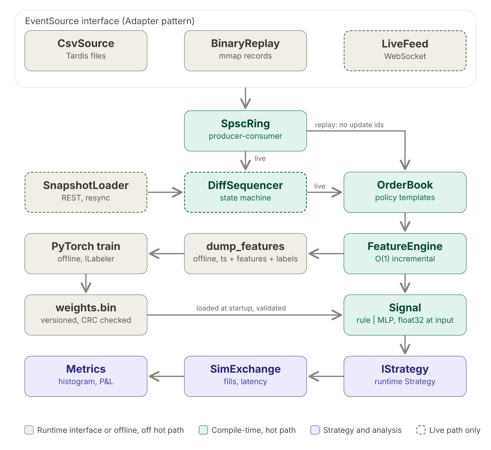

# tickbook

C++20 tick-data replay, L2 order book and (later) backtest engine for crypto market data.
Header-only core, GoogleTest tests, CI with ASan/UBSan/TSan on GCC and Clang.

## Status

Milestones 1, 2.1–2.6, 2.8, 3.1–3.3, 4.2, and 4.4 are complete. Milestone 4.1 adds a Release-only
per-event replay histogram; its Linux zero-minor-fault assertion still needs a Linux run. The
milestone 4.3 five-run comparison is recorded below; its Linux `perf` flame graph remains pending.
`compare_books` matched `BookMap`,
`FlatBook`, and `OffsetArrayBook` after every event in the 2019-12-01 Binance BTCUSDT replay
(6,907,104 events). Milestone 2.7 tooling is implemented: parser fuzz targets, CI gates, a
local gate script, and a pinned Ubuntu toolchain. Current AppleClang plain, ASan/UBSan, and
TSan runs each pass all 74 tests. The Ubuntu workflow's Linux-only fuzz and static-analysis
gates have not yet run from this workspace.

## Build and test

    cmake -S . -B build -DCMAKE_BUILD_TYPE=RelWithDebInfo
    cmake --build build -j
    ctest --test-dir build --output-on-failure

With sanitizers: add `-DTICKBOOK_SANITIZE=address,undefined` or `-DTICKBOOK_SANITIZE=thread`.
Building `csv_to_bin` requires the system zlib development package.

Run the local gate set with `scripts/check.sh`. It builds and tests plain, ASan/UBSan, and
TSan configurations, runs formatting and clang-tidy, runs Python tests when `python/tests`
exists, then builds and runs the fuzz smoke corpora. The fuzzer targets cover `parse_fixed`,
the converter's CSV record parser, binary headers/events, and `DiffSequencer`. Binary seeds
are stored as hex text and materialized only in a temporary directory.

The `alloc_check` test creates a deterministic 512-event fixture outside the repository.
It counts allocations around mapped event reads and SPSC transfers, and uses a separate
`BookMap` allocation as a positive control. `BookMap` remains exempt from the zero-allocation
assertion because it is the `std::map` baseline.

## Synthetic data

`gen_synthetic` writes deterministic `incremental_book_L2.csv.gz` and `trades.csv.gz`
files in Tardis format. It generates a five-level snapshot, seeded random-walk updates,
level removals, and trades. Keep generated files outside the repository.

    build/gen_synthetic --output-dir /tmp/tickbook-synthetic --seed 42 --messages 100
    build/csv_to_bin --book /tmp/tickbook-synthetic/incremental_book_L2.csv.gz \
      --trades /tmp/tickbook-synthetic/trades.csv.gz --output /tmp/tickbook-synthetic/events.bin \
      --symbol BTCUSDT --price-scale 2 --qty-scale 8
    build/replay /tmp/tickbook-synthetic/events.bin

## CSV conversion

    build/csv_to_bin --book BTCUSDT-book.csv.gz --trades BTCUSDT-trades.csv.gz \
      --output BTCUSDT.bin --symbol BTCUSDT --price-scale 2 --qty-scale 8

The trade file is optional. The converter preserves capture order within each input stream.
It clamps each stream's event time to its running maximum, then stable-merges by that clamped
time, with book rows before trade rows on ties. It counts timestamp backsteps and reports
the largest; a single backstep above `--max-backstep-ms` (default 1000) aborts conversion.
The last row of each consecutive `local_timestamp` group receives the end-of-message flag.
It skips book rows until the first snapshot. Event flag bit 1 marks the first row after a
transition into a snapshot and tells the consumer to clear its book before applying that
level. Tardis data remains local and is not included in the repository.

`BinaryReplay` keeps event records as views into the mapped file. On Linux it requests
`MAP_POPULATE` and locks the mapped pages; the process needs a locked-memory allowance
large enough for the replay file.

    build/replay BTCUSDT.bin

`replay` reports the event count, final best levels and depth counts, plus a deterministic
checksum over the complete final book. It clears the book when it reaches a snapshot-start
event. The replay uses a lossless producer-to-consumer SPSC ring; it yields while waiting
for space or data outside latency measurement runs. Linux pins producer and consumer to
distinct physical cores; macOS does not support this pinning path.

## Latency histogram (milestone 4.1)

Build the Release-only benchmark separately from sanitizer builds:

    cmake -S . -B build-bench -DCMAKE_BUILD_TYPE=Release \
      -DTICKBOOK_BUILD_BENCHMARKS=ON -DBUILD_TESTING=OFF
    cmake --build build-bench --target replay_latency -j
    build-bench/replay_latency BTCUSDT.bin --book map --price-tick 1

`--book` accepts `map`, `flat`, or `offset`. The tool maps and pre-touches the event file,
does one full warm-up replay, then times each successful ring pop through snapshot handling
and book apply. It subtracts the average back-to-back `steady_clock` read overhead. The fixed
histogram has exact 0–31 ns buckets and 32 sub-buckets per power of two above that; reported
percentiles are the selected bucket's upper edge and `max_ns` is exact. Linux pins both threads,
uses the replay mapping's `MAP_POPULATE`/`mlock` path, and fails if process minor faults are
nonzero. macOS cannot pin threads; it reports process-wide minor faults without asserting zero.

One measured `BookMap` pass over BTCUSDT 2019-12-01 on the Apple M2 MacBook Air (macOS 27.2.1),
Apple LLVM 21.0.0, `-O3 -DNDEBUG -Wall -Wextra -Wpedantic -Wshadow -Werror`, covered 6,907,104
events after one full warm-up pass. It reported p50 26 ns, p99 109 ns, p99.9 151 ns, max
61,734 ns, a 16 ns timer-overhead estimate, and 3 process-wide minor faults. This is the initial
single BookMap run; the five-run layout comparison appears below. These are replay processing
numbers, not trading latency.

### Five-run replay comparison (milestone 4.3)

Each cell shows the median of five per-run measurements and the min–max run range. All runs used
the same Binance BTCUSDT 2019-12-01 binary (6,907,104 events), one full warm-up before measurement,
and 30 seconds between runs. Layouts ran interleaved. Hardware: Apple M2 MacBook Air, 8 GB, macOS
27.2.1; compiler: Apple LLVM 21.0.0; flags: `-O3 -DNDEBUG -Wall -Wextra -Wpedantic -Wshadow
-Werror`. These are replay ring-pop-to-book-apply latencies after subtracting the measured timer
overhead, in nanoseconds. They are not trading latency.

| Book layout | p50 ns | p99 ns | p99.9 ns | Max ns |
| --- | ---: | ---: | ---: | ---: |
| `BookMap` | 28 (27–61) | 111 (111–231) | 155 (155–991) | 54,527 (11,069–3,124,728) |
| `FlatBook` | 1,055 (1,055–1,087) | 2,111 (2,111–3,007) | 2,495 (2,175–16,383) | 5,262,236 (82,901–73,262,861) |
| `OffsetArrayBook` | 28 (26–28) | 28 (28–109) | 111 (111–195) | 789,570 (753,527–1,832,942) |

All five OffsetArrayBook runs had zero measured hot-path allocations. All five FlatBook runs had
zero; BookMap allocated 2,671,052 times per run. macOS reports process-scoped minor faults rather
than asserting zero: run counts ranged 1–10 for BookMap, 1–24 for FlatBook, and 0–2 for
OffsetArrayBook. The fanless M2 showed substantial max-latency and fault-count spread, so the
percentile ranges are shown and the exact maxima are not used to set the budget. The Linux x86
comparison and flame graph remain needed for the authoritative pinned-core profile.

To capture that profile on Linux with `perf` and Brendan Gregg's FlameGraph scripts available on
`PATH`, build the benchmark with debug symbols and run the best measured layout:

    cmake -S . -B build-profile -DCMAKE_BUILD_TYPE=RelWithDebInfo \
      -DTICKBOOK_BUILD_BENCHMARKS=ON -DBUILD_TESTING=OFF
    cmake --build build-profile --target replay_latency -j
    scripts/profile-replay-linux.sh /path/to/BTCUSDT.bin docs/replay-offset.svg 1

The script records the OffsetArrayBook replay with `perf record`, folds stacks, and writes the SVG.
The profile is diagnostic; use unprofiled runs for the benchmark table. The current Apple Silicon
workspace has no Linux `perf`, Docker, or Instruments command-line tools, so no flame graph is
claimed here.

## Per-event latency budget (milestone 4.4)

The target is **p99 <= 500 ns/event** for ring pop, book update, feature update, and signal
evaluation; NN inference shares this total. The budget is based on the OffsetArrayBook baseline
measured on the Apple M2 MacBook Air, macOS 27.2.1: median p99 28 ns and median p99.9 111 ns over
five runs. The 500 ns target is about 4.5 times that measured p99.9, leaving room for later stages.
The baseline currently measures only ring pop through book apply, so each later stage must be
added to the same end-to-end measurement before it can be considered within budget. Recheck the
target against the pinned Linux x86 results when those are available.

## Allocation counter (milestone 4.2)

The Release replay benchmark replaces global `operator new` and counts allocations from the
startup-done marker through producer and consumer completion. Flat and offset book runs fail on
any hot-path allocation. The `BookMap` run must record at least one allocation as a positive
control. The CI allocation job runs the benchmark on the same small deterministic fixture used by
`alloc_check`.

## Order book layouts

`BookMap` is the full-depth reference. `FlatBook` stores the best 4,096 levels per side by
default. At capacity it drops the worst retained level when a better one arrives and ignores
updates below its retained range. It reserves its vectors at construction. `OffsetArrayBook`
uses a fixed window of 65,536 price ticks by default; pass the fixed-point tick size as the
second constructor argument when it is greater than one. Its circular storage slides the
window to include out-of-range updates and drops levels that leave the window. Both optimized
books avoid allocations during updates.

`compare_books` pre-scans a binary file to size both bounded books for the observed price
range, then compares best levels, counts, crossed state, and top five levels after every event.
The binary header does not contain the exchange tick size, so pass it as an integer number of
fixed-point price units when it is greater than one (the default is one):

    build/compare_books /path/to/day.bin --price-tick 1

The validator rejects files whose price span exceeds six million ticks.

On the final BookMap state from BTCUSDT 2019-12-01 (3,415 bid levels, 3,783 ask levels),
the old full traversal averaged 51,832 ns per bid+ask top-five query (run range 46,388–53,535 ns);
stopping each visitor after five levels averaged 7.02 ns (6.59–9.81 ns). Each median is
from seven runs of 20,000 queries. Hardware: Apple M2 MacBook Air, macOS 27.2.1. Compiler:
Apple LLVM 21.0.0, `-O3 -DNDEBUG -Wall -Wextra -Wpedantic -Wshadow -Werror`. This is a
batch-average visitor microbenchmark with the book already in memory, not replay event latency;
runs were back-to-back without a cool-down.

### Preliminary book-apply microbenchmark

This measures an in-memory event loop, not end-to-end replay latency. Each value is the
median elapsed batch time divided by 150,010 events across seven runs; the ranges show the
minimum and maximum run averages. The same seeded synthetic BTCUSDT file (seed 4242,
50,000 messages) was used for each layout. Hardware: Apple M2 MacBook Air, macOS 27.2.1.
Compiler: Apple LLVM 21.0.0, `-O3 -DNDEBUG -Wall -Wextra -Wpedantic -Wshadow -Werror`.
No minor faults were observed in the measured loops. These are batch averages, not per-event
tail percentiles; milestone 4 adds the latency histogram. Runs were back-to-back without a
cool-down, so treat the ranges as exploratory on the fanless M2 Air.

| Layout | Median ns/event | Run range ns/event |
| --- | ---: | ---: |
| `BookMap` | 8.65 | 7.86–9.82 |
| `FlatBook` | 9.85 | 9.46–10.81 |
| `OffsetArrayBook` (circular recentering) | 3.39 | 3.24–3.42 |
| `OffsetArrayBook` before circular recentering | 23.62 | 21.59–31.56 |

The circular recentering change reduced the offset book's median on this fixture by about
86%. `FlatBook` was slower than `BookMap` on this shallow synthetic stream, so these numbers
do not establish a general speedup for the flat layout.

## Design rules

- Prices and quantities are `int64` fixed-point. No `double` on the hot path.
- One producer thread and one consumer thread, joined by `SpscRing`.
- No heap allocation on the hot path (the `std::map` book is the baseline that breaks this on purpose).
- The sequencer rules follow the Binance spot docs at the time of writing. Re-check them.

## Architecture

## Roadmap

1. Milestones 3.1–3.3, 4.2, and 4.4 complete; milestone 4.1 implemented, with a Linux zero-fault run pending.
2. Milestone 4.3: five-run Mac comparison complete; Linux x86 comparison and `perf` flame graph pending.
3. Milestone 5: features, signal evaluation and out-of-sample baselines.
4. Milestone 6: offline labels, training and C++ inference, only if the signal evaluation warrants it.
5. Milestone 7: strategy interfaces, simulated exchange and metrics.
6. Milestone 8: manual live recorder and replay validation.

See [AGENTS.md](AGENTS.md) for the full project brief, milestone checklist, and correctness gates.

## Limits

- This is replay processing latency on the stated hardware, not live trading latency.
- Price-level (L2) book only: Binance does not publish individual orders.
- Free sample data covers one day per month, so strategy results are not evidence of profitability.
